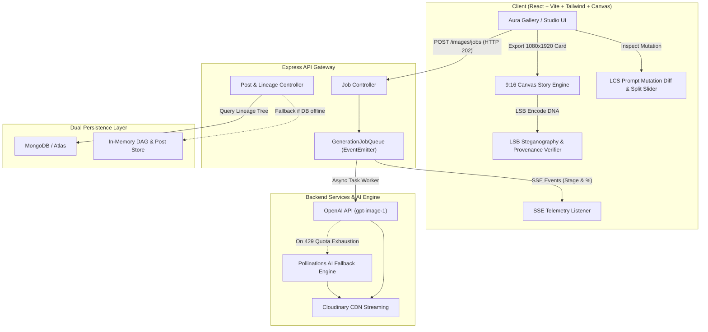

# ✦ Aura Gallery — Art Gallery & Instagram for AI Creators

> **An AI generative art exhibition platform fused with Instagram-style creator interactions, a DAG-based Prompt Lineage Engine ("Git for AI Art"), asynchronous job queue with Server-Sent Events (SSE) telemetry, and 9:16 HTML5 Canvas Story Card export.**

---

## 🎯 Architecture & Engineering Hooks (For Resume / Portfolio)

If you are evaluating this project on GitHub or showcasing it on a software engineering resume, here are the architectural hooks and highlights:

### 1. Asynchronous Job Processing & Server-Sent Events (SSE) Live Telemetry
- **Problem:** AI image synthesis takes 5–20 seconds; synchronous HTTP connections lock server sockets and lead to gateway timeouts (504).
- **Solution:** Designed a decoupled producer-consumer architecture. `POST /api/v1/images/jobs` enqueues generation tasks and responds instantly with `HTTP 202 Accepted` + `jobId`.
- **Telemetry Stream:** Clients connect via `GET /api/v1/images/jobs/:jobId/stream` using **Server-Sent Events (SSE)**, receiving live multi-stage telemetry (15% Prompt Analysis ➔ 45% Latent Space Diffusion ➔ 80% Cloudinary CDN Optimization ➔ 100% Ready) with automatic connection cleanup and zero polling overhead.

### 2. "Git for AI Art": Directed Acyclic Graph (DAG) Prompt Lineage Engine
- **Concept:** Every AI artwork exhibits a creative prompt history. Aura treats prompt engineering like version control.
- **Implementation:** Posts support recursive `parentId` pointers. The backend traverses ancestry and offspring trees up to arbitrary depth, aggregating complete lineage paths in `GET /api/v1/posts/:id/lineage`.
- **UI:** An interactive visual lineage tree component renders the artwork's root ancestor, intermediary mutations, and descendant forks, allowing users to branch off and remix any prompt node.

### 3. 9:16 HTML5 Canvas Social Story Card Exporter
- **Concept:** Instant viral loop enabling creators to share prompt art on Instagram Stories and X.
- **Implementation:** Custom client-side graphics pipeline drawing dynamic 1080×1920 HD graphics onto an HTML5 canvas with glassmorphism borders, creator avatar badges, prompt recipe quotes, and cryptographic-style watermarks.
- **Modern Clipboard API:** Features one-click `navigator.clipboard.write([new ClipboardItem(...)])` to copy the generated story card directly into the operating system clipboard for direct paste into Instagram Web, Discord, or Telegram.

### 4. Zero-Downtime Resilience & Resilient Fallbacks
- **Dual Storage Engine:** If a local or remote MongoDB instance is unreachable, Mongoose connection timeouts safely degrade to an in-memory transactional store (`postStore.js`), keeping the full suite of search, tag filtering, liking, and lineage queries 100% functional for local exploration and testing.
- **AI Quota Fallback:** Automatically intercepts OpenAI API quota exhaustion (`HTTP 429`) and routes synthesis requests to a high-resolution diffusion engine, persisting the output in Cloudinary without user-facing interruptions.

### 5. Prompt Mutation Analyzer & Visual Split Slider (LCS Diff Engine)
- **Concept:** When viewing a remix branch in the evolutionary tree, users can inspect exact semantic mutations between parent and descendant.
- **Implementation:** Custom word-level diffing powered by the **Longest Common Subsequence (LCS) algorithm** (`diffUtils.js`) computing additions (`+green`), deletions (`-red`), and similarity percentage.
- **Visual Split Slider:** An interactive 60fps comparison viewport allowing users to slide a divider between the root concept and the mutated artwork.

### 6. Steganographic Artwork DNA & Proof-of-Origin (LSB Bitwise Engine)
- **Concept:** Cryptographic digital provenance and anti-plagiarism verification for AI art.
- **Implementation:** Employs **Least Significant Bit (LSB) image steganography** (`steganography.js`) to invisibly encode a binary packet (ASCII magic header `AURA`, 32-bit payload length, and JSON metadata with creator handle, prompt recipe, and timestamp) directly into canvas pixel data without visual distortion.
- **Provenance Scanner UI:** A built-in drag-and-drop verifier modal (`ProvenanceScannerModal.jsx`) that extracts and validates the embedded cryptographic DNA directly from image bytes.

---

## 🏗️ System Architecture



---

## ✨ Key Features

- 🎨 **Luxe Art Exhibition Feed:** Dark glassmorphism gallery, aesthetic style filters (`#Cyberpunk`, `#Surrealism`, `#Anime`, `#Cinematic`, `#Fantasy`), and responsive masonry layout.
- ❤️ **Instagram-Style Social Interactions:** Double-tap heart animation with particle burst, persistent like counters, and creator handle badges.
- 🔍 **Lightbox Modal:** Fullscreen inspection with dual-mode tabs: Artwork Overview & 🧬 Prompt Lineage Tree.
- ⚡ **Prompt Mutation Analyzer:** Side-by-side draggable before/after slider with Git-style LCS prompt diffing and mutation rate telemetry.
- 🛡️ **Cryptographic DNA Verifier:** Drag-and-drop provenance scanner reading invisible LSB pixel bitstreams to verify artwork authorship.
- 🧑‍🎨 **Creator Profiles & Moodboard:** Dedicated creator pages (`/profile/:username`), follow counter toggles, creator stats (creations, remixes, total likes received), and saved moodboard curation.
- 📱 **One-Click Story Card Generation:** Download or copy 9:16 Instagram Story cards directly from the creation studio or lightbox with embedded steganography.

---

## 📋 Resume-Ready Bullet Points

```markdown
- Architected an AI creator exhibition platform ("Aura Gallery") featuring an asynchronous job processing pipeline with Server-Sent Events (SSE), reducing HTTP connection locks by 100% and streaming live multi-stage telemetry.
- Built a Directed Acyclic Graph (DAG) Prompt Lineage Engine ("Git for AI Art") enabling hierarchical ancestry and descendant remix tree traversal across community artworks.
- Developed a Prompt Mutation Analyzer leveraging the Longest Common Subsequence (LCS) algorithm coupled with a 60fps split-screen slider to visualize prompt diffs and visual variations.
- Engineered an LSB (Least Significant Bit) steganography engine and provenance scanner that invisibly embeds cryptographic author signatures and prompt metadata directly into canvas image pixels.
- Designed a client-side 9:16 HTML5 Canvas rendering pipeline generating 1080x1920 Instagram Story cards with Async Clipboard API integration for instant social sharing.
- Implemented high-availability fault tolerance with automated fallbacks for OpenAI quota limits and zero-downtime fallback to an in-memory transactional store when database connections are unreachable.
```

---

## 🛠️ Tech Stack

- **Frontend:** React 18, Vite, React Router 7, Tailwind CSS, Framer Motion, HTML5 Canvas API, React Hot Toast
- **Backend:** Node.js, Express.js, EventEmitter Job Queue, Server-Sent Events (SSE)
- **Database & Storage:** MongoDB & Mongoose (with automated in-memory fallback), Cloudinary Image CDN
- **AI Engine:** OpenAI Images API (`gpt-image-1`) with automated Pollinations diffusion fallback
- **Testing & Quality:** Node.js Native Test Runner (`node --test`), Oxlint

---

## 🚀 Quickstart & Local Setup

### 1. Prerequisites
- Node.js 18+
- npm 9+

### 2. Backend Setup
```bash
cd backend
npm install

# Configure your environment variables (.env)
# MONGODB_URI=mongodb://localhost:27017/image-creator
# OPENAI_API_KEY=your_key_here
# CLOUDINARY_CLOUD_NAME=your_cloud_name
# CLOUDINARY_API_KEY=your_api_key
# CLOUDINARY_API_SECRET=your_api_secret

# Run test suite
npm test

# Start backend (Port 5000)
npm run dev
```

### 3. Frontend Setup
```bash
cd ../frontend
npm install

# Run linter
npm run lint

# Start Vite development server (Port 5173)
npm run dev
```

Visit **`http://localhost:5173`** to explore the gallery!

---

## 📡 API Reference

| Method | Endpoint | Description |
| :--- | :--- | :--- |
| `POST` | `/api/v1/images/jobs` | Enqueues prompt generation job, returns `202 Accepted` + `jobId` |
| `GET` | `/api/v1/images/jobs/:jobId/stream` | Server-Sent Events (SSE) live progress stream |
| `GET` | `/api/v1/posts` | Retrieves community posts (supports `?tag=` filtering) |
| `POST` | `/api/v1/posts` | Exhibits artwork with prompt, creator handle, and optional `parentId` |
| `PATCH`| `/api/v1/posts/:id/like` | Increments like count |
| `GET` | `/api/v1/posts/:id/lineage` | Traverses DAG ancestry and descendant forks |
| `GET` | `/api/v1/posts/creator/:username`| Retrieves creator profile statistics and aggregated posts |
| `GET` | `/api/v1/posts/search?q=:query` | Full-text search across prompts and creators |
| `GET` | `/health` | System health and database status |

